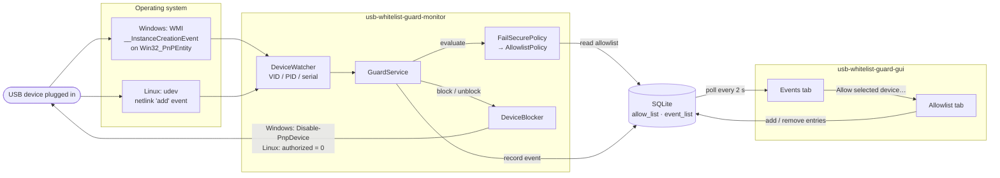
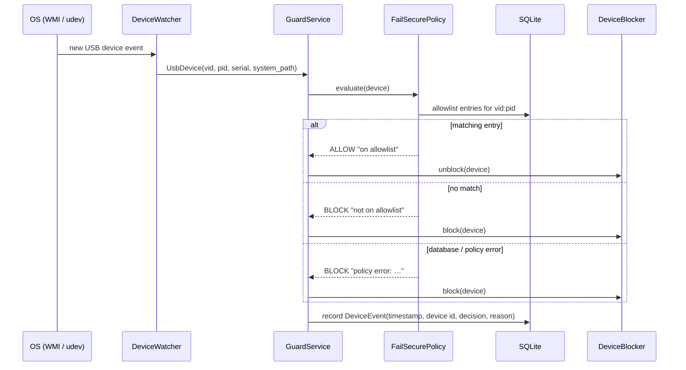

# usb-whitelist-guard

Blocks USB devices that are not on an allowlist. A background **monitor** watches for newly connected USB devices, checks each one's VID/PID/serial against the allowlist and disables unknown devices immediately. A desktop **GUI** manages the allowlist and shows the event history.

Works on Windows and Linux from one Python codebase.

| Allowlist | Events |
|---|---|
|  |  |

## How it works



Handling a single device:



### Device detection

| | Windows | Linux |
|---|---|---|
| Source | WMI query `__InstanceCreationEvent WITHIN 1` on `Win32_PnPEntity` with `PNPDeviceID LIKE 'USB\VID_%'` | udev netlink monitor, `subsystem=usb`, `device_type=usb_device`, action `add` |
| Latency | up to ~1 s (WMI polls internally) | immediate (kernel pushes the event) |
| Device ID | parsed from `USB\VID_xxxx&PID_xxxx\<serial>` | sysfs attributes `idVendor`, `idProduct`, `serial` |
| Blocking | `Disable-PnpDevice` (PowerShell) | write `0` to `/sys/bus/usb/devices/<dev>/authorized` |

On Windows, an instance ID whose last segment contains `&` is generated by Windows and is not a real serial number, so the device's serial is treated as unknown.

### Allowlist matching

Every entry has a VID and PID (4 hex digits) and an optional serial number:

- **with a serial**, the entry only allows that one physical device;
- **without a serial** ("any"), it allows every device with that VID:PID.

### Fail-secure

Every device is blocked when its state can't be checked:

- `FailSecurePolicy` turns any exception during evaluation (e.g. the database is unreachable) into a `BLOCK` verdict.
- If the database can't be opened or migrated at startup, the monitor logs the error and keeps running, so every new device is blocked.
- Failing to block or to record an event is logged and included in the event reason; it doesn't stop the monitor.

## Project layout

A [uv workspace](https://docs.astral.sh/uv/concepts/projects/workspaces/) with three packages:

```
packages/core/   usb-whitelist-guard-core     domain model, policies, services, SQLite storage + Alembic migrations
apps/monitor/    usb-whitelist-guard-monitor  background service: platform watchers and blockers
apps/gui/        usb-whitelist-guard-gui      Tkinter app for the allowlist and event history
```

The core is split into layers:

| Package | Contents |
|---|---|
| `domain` | `DeviceId`, `UsbDevice`, `AllowlistEntry`, `DeviceEvent`, `Decision` / `Verdict`, errors |
| `ports` | protocols: `DeviceWatcher`, `DeviceBlocker`, `AllowlistReader` / `Writer`, `EventSink` / `Reader` |
| `policy` | `AllowlistPolicy`, `FailSecurePolicy` |
| `services` | `GuardService` (used by the monitor), `AllowlistService` (used by the GUI) |
| `storage` | SQLAlchemy models, repositories, Alembic migrations |

Platform code depends only on the `ports`, so you can add a new OS by implementing `DeviceWatcher` and `DeviceBlocker` in `apps/monitor/.../platforms/`.

## Installation

Requires Python 3.15+ and [uv](https://docs.astral.sh/uv/).

```bash
uv sync --all-packages
```

Platform dependencies are installed automatically: `wmi` (and `pywin32`) on Windows, `pyudev` on Linux. The GUI uses Tkinter from the standard library. Some Linux distributions ship it as a separate package, e.g. `python3-tk`.

## Usage

Both apps need **administrator / root** privileges. The monitor writes to the device stack, and both apps write to the shared database, which by default lives in a system location.

```bash
uv run usb-whitelist-guard-monitor
uv run usb-whitelist-guard-gui
```

## Requirements

### Functional

- Detect newly connected USB devices in real time (Linux: udev, Windows: WMI).
- Read device VID/PID (and serial if available) and check it against the allowlist.
- Automatically block unknown devices (Linux: sysfs `authorized = 0`, Windows: `Disable-PnpDevice`).
- Log each event with timestamp, device ID and decision.

### Non-functional

- Runs on Linux and Windows from one Python codebase.
- Requires root / administrator privileges.
- Fail-secure: if the allowlist is missing or invalid, unknown devices are blocked.
